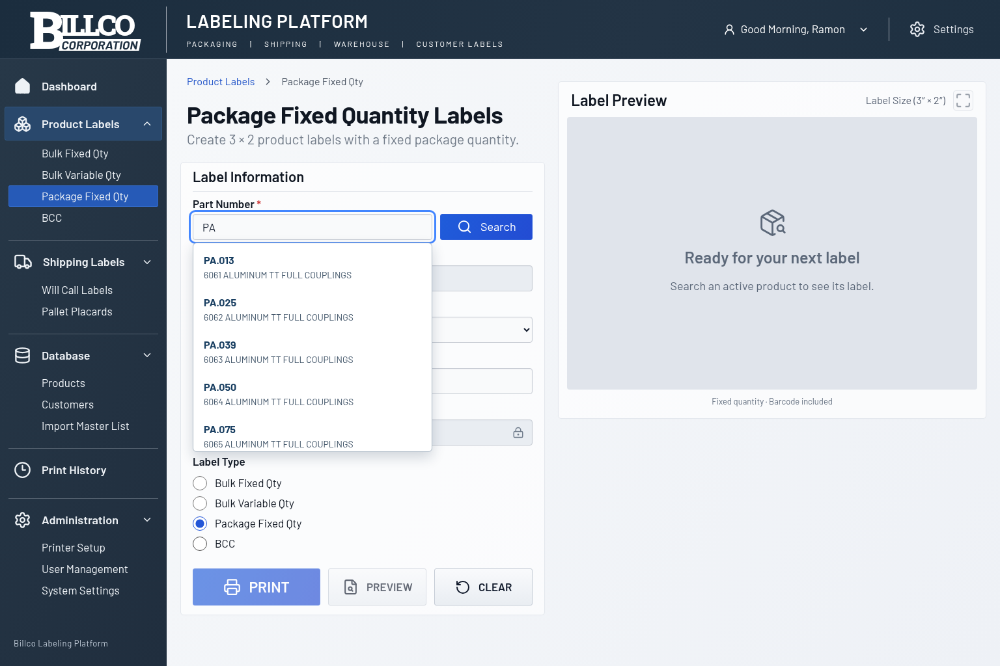
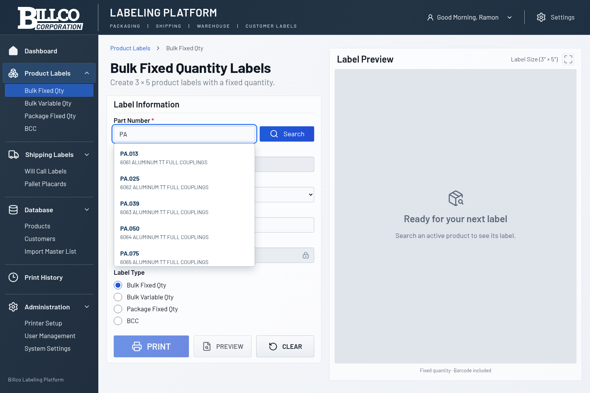
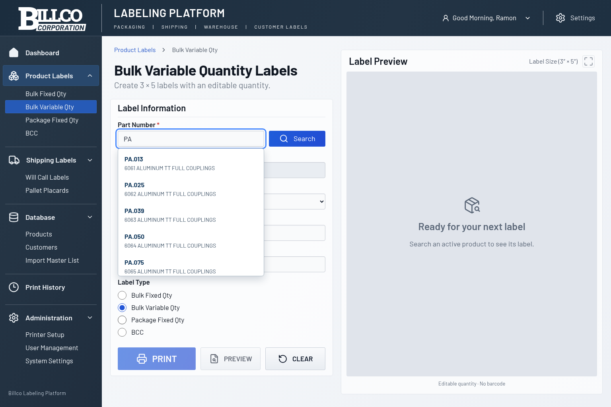
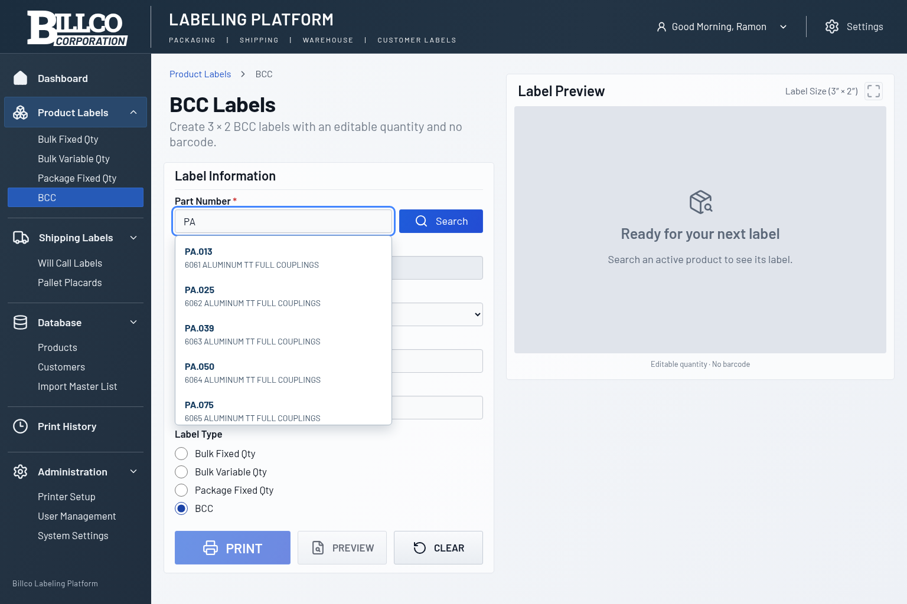

# Part Number autocomplete

Type any portion of a part number or description. Matching ignores letter case
and leading/trailing whitespace. The dropdown shows up to ten products, ordered
by part-number prefix, part-number substring, then description substring, with
part number breaking ties. This follows the updated Issue #19 requirement of ten
results. Descriptions and identifiers are displayed exactly as seeded/imported.

Click a result or use Up/Down and Enter to load it and refresh the label preview.
Escape and leaving the field dismiss suggestions. Enter without a highlighted
suggestion immediately performs exact lookup, including while suggestions are
still pending. A unique exact part-number suggestion also loads directly with
Enter. Search remains available for exact lookup.

The search endpoint is `GET /api/products/search?q=...`. SQLite uses bound
parameters and literal substring matching (wildcards such as `%` are literal),
a deterministic relevance order, and `LIMIT 10`. The UI waits 100 ms after typing,
cancels obsolete requests, and ignores stale responses. Selection reuses the
existing exact lookup so status, fixed quantities, independent barcodes, and
missing-data restrictions are preserved for every label format. Bulk Variable
and BCC continue to require an operator quantity and omit barcodes.

## Seeded BillcoMaster screenshots

| Package Fixed | Bulk Fixed |
| --- | --- |
|  |  |

| Bulk Variable | BCC |
| --- | --- |
|  |  |
