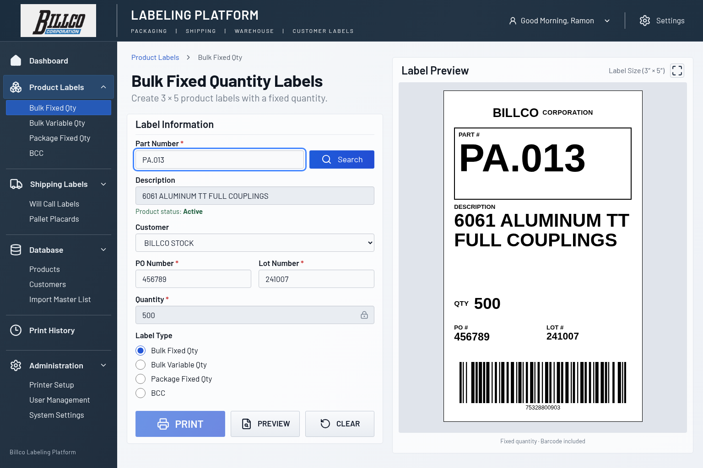
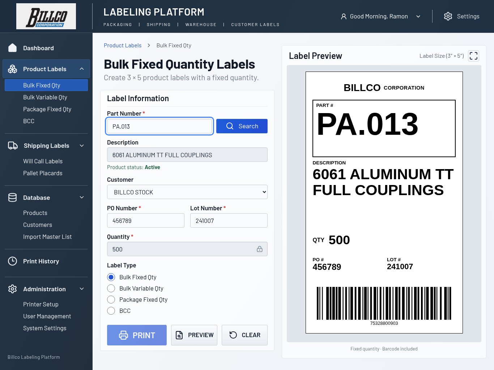
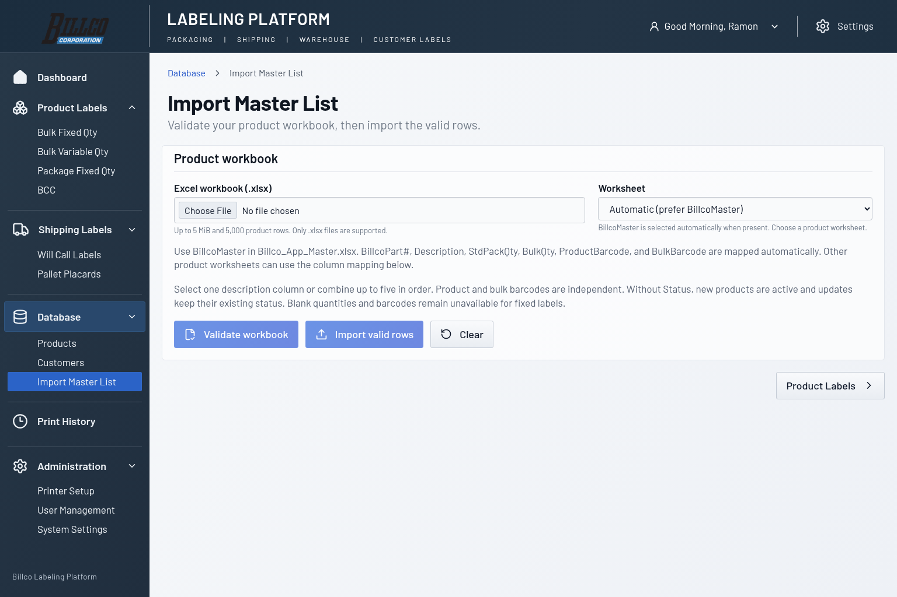
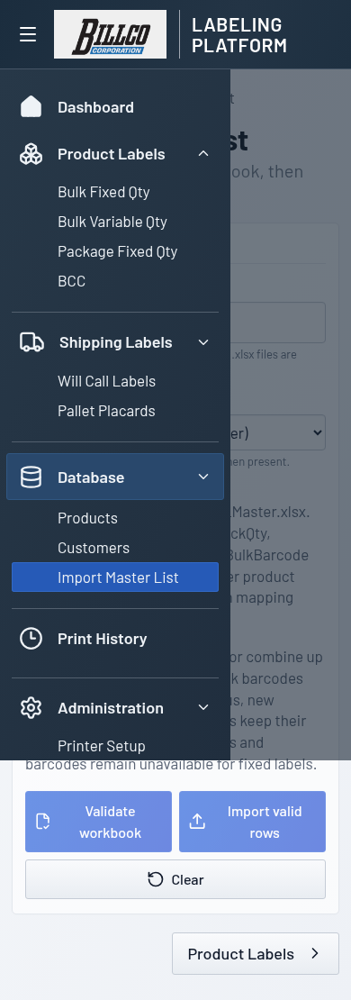
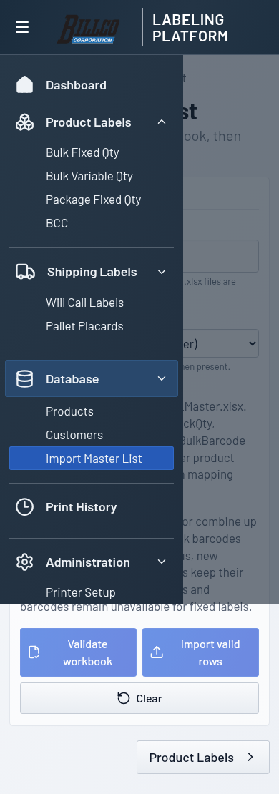

# Official Billco application logo

The application uses the official Billco artwork supplied for
[Issue #24](https://github.com/ramongjr-source/billco-label-management/issues/24),
committed at `public/assets/billco-logo.png`. It is based on the PNG in the
uploaded `Screenshot 2026-10-29 095309.zip`, with its light-gray background
removed as requested.

- Canvas: 457 × 201 pixels (RGBA PNG), retaining the original aspect ratio,
  artwork placement, and margins.
- Transparent asset SHA-256:
  `6caa7c9d8efe09e32fb3a2ddf5802ef2509c376688538a1dfe378cffabf88feb`.
- The outer background and spaces inside the black letters are transparent.
  Background edge pixels use alpha to avoid a light fringe on the blue shell.
- Opaque foreground pixels retain their original colors. The blue CORPORATION
  banner and all of its white lettering remain intact. No shadows, outlines,
  added artwork, or CSS effects are used.

`src/components/BillcoLogo.tsx` references `/assets/billco-logo.png`, served by
the application itself in development and production. No runtime GitHub URL
or external image service is used. Accessible alt text identifies the image.
Native width/height attributes reserve its proportions; responsive CSS sets
its width and leaves height automatic. No cropping, recoloring, skewing,
filters, or text approximation is applied. The simulated wordmark styles and
unused Roboto Slab font import have been removed.

The shared header provides the branding above the existing sidebar on Product
Labels (all four label types) and Import Master List. Navigation, sidebar
widths, and functionality remain unchanged. Thermal label branding and
barcodes retain their existing rendering.

## Verification

Browser verification blocks external HTTPS requests and confirms the local
image decodes at its native dimensions, retains its aspect ratio, stays inside
the header, and does not overlap the adjacent platform heading. All four label
modes and Import Master List are checked at 320, 390, 768, 1024, 1280, 1366,
and 1536 pixels wide. Header, sidebar, and workspace dimensions match the
before-change baselines; there is no page-wide horizontal overflow.

The production build and existing server/browser test suites are also run.

## Before and after

The before captures use `de79890`; after captures use the local repository
asset. Desktop and laptop captures show seeded `PA.013`. Import captures show
the shared header; mobile captures show the header and expanded navigation.

| Desktop: before | Desktop: after |
| --- | --- |
|  |  |

| Laptop: before | Laptop: after |
| --- | --- |
|  |  |

| Import: before | Import: after |
| --- | --- |
|  |  |

| Mobile navigation: before | Mobile navigation: after |
| --- | --- |
|  |  |

## Transparent-background refinement

These captures compare the original opaque logo with the transparent local
asset on the existing blue header/sidebar background.

| Desktop: opaque background | Desktop: transparent background |
| --- | --- |
|  |  |

| Laptop: opaque background | Laptop: transparent background |
| --- | --- |
|  |  |

| Import: opaque background | Import: transparent background |
| --- | --- |
|  |  |

| Mobile: opaque background | Mobile: transparent background |
| --- | --- |
|  |  |
