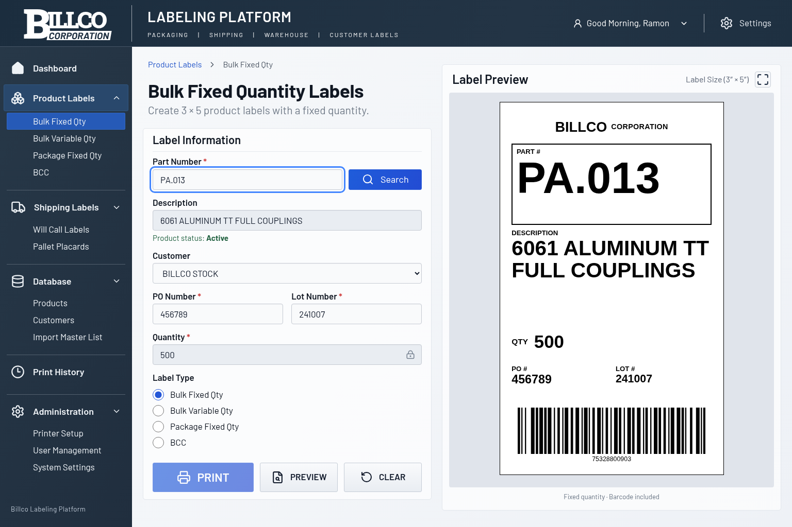
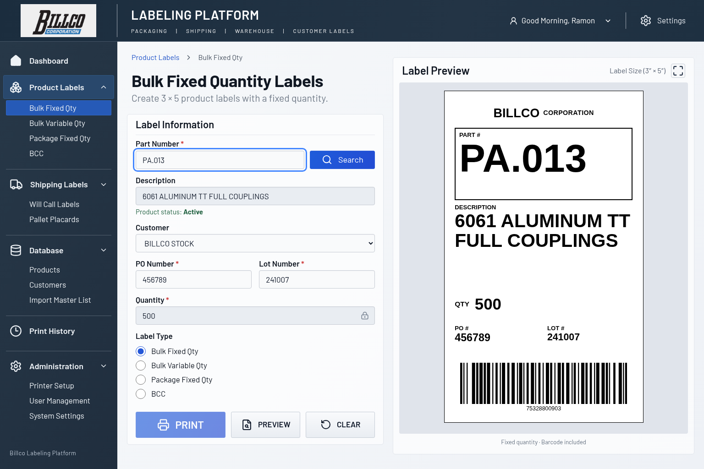
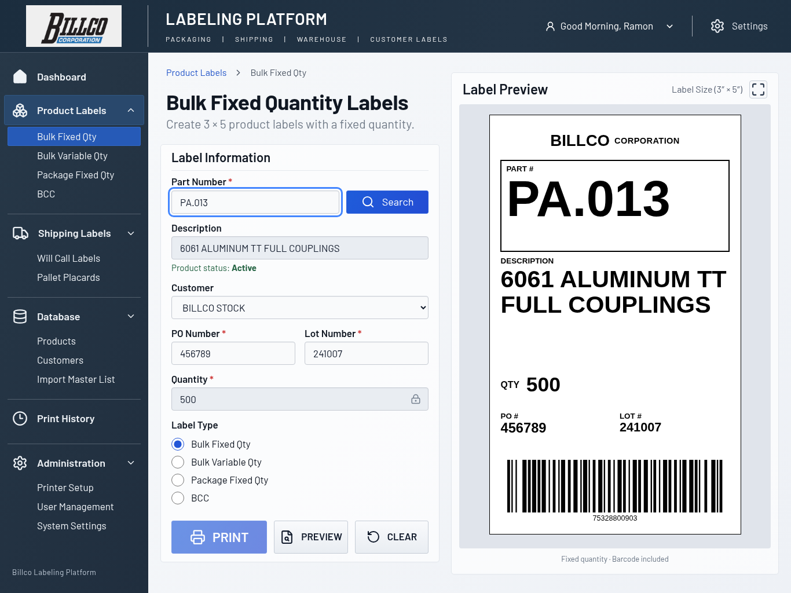
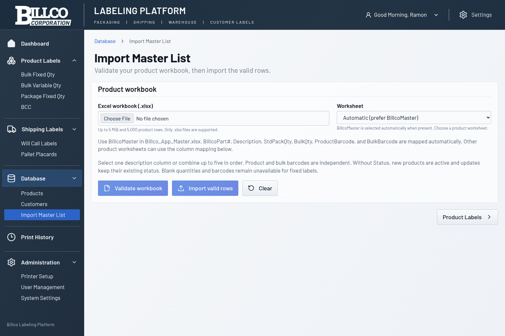
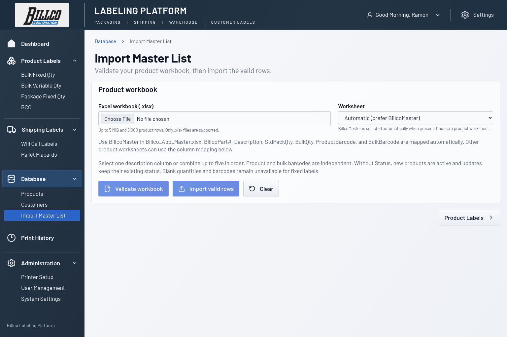
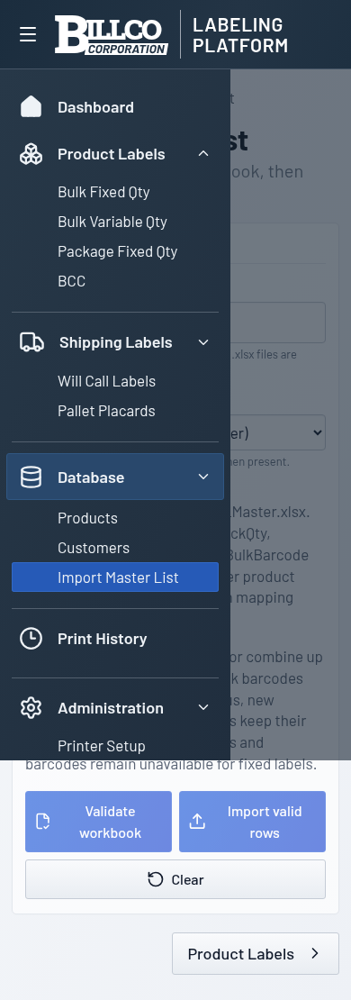

# Official Billco application logo

The application uses the original PNG supplied for
[Issue #24](https://github.com/ramongjr-source/billco-label-management/issues/24),
committed at `public/assets/billco-logo.png`. It was copied directly from the
uploaded `Screenshot 2026-10-29 095309.zip`; no image processing was applied.

- Native size: 457 × 201 pixels (RGBA PNG).
- SHA-256: `818eeca394e4b22c186d7581ae6e8cbacc457ed3cc28dc2c518b9caccc15e801`.
- The asset matches the uploaded file byte-for-byte. The original light-gray
  background, artwork, colors, and alpha channel are preserved.

`src/components/BillcoLogo.tsx` references `/assets/billco-logo.png`, served by
the application itself in development and production. No runtime GitHub URL
or external image service is used. Accessible alt text identifies the image.
Native width/height attributes reserve its proportions; responsive CSS sets
its width and leaves height automatic. No cropping, recoloring, skewing,
filters, or text approximation is applied. The simulated wordmark styles and
unused Roboto Slab font import have been removed.

The shared header provides the branding above the existing sidebar on Product
Labels (all four label types) and Import Master List. Navigation, sidebar
widths, and functionality remain unchanged. Thermal label branding and
barcodes retain their existing rendering.

## Verification

Browser verification blocks external HTTPS requests and confirms the local
image decodes at its native dimensions, retains its aspect ratio, stays inside
the header, and does not overlap the adjacent platform heading. All four label
modes and Import Master List are checked at 320, 390, 768, 1024, 1280, 1366,
and 1536 pixels wide. Header, sidebar, and workspace dimensions match the
before-change baselines; there is no page-wide horizontal overflow.

The production build and existing server/browser test suites are also run.

## Before and after

The before captures use `de79890`; after captures use the local repository
asset. Desktop and laptop captures show seeded `PA.013`. Import captures show
the shared header; mobile captures show the header and expanded navigation.

| Desktop: before | Desktop: after |
| --- | --- |
|  |  |

| Laptop: before | Laptop: after |
| --- | --- |
|  |  |

| Import: before | Import: after |
| --- | --- |
|  |  |

| Mobile navigation: before | Mobile navigation: after |
| --- | --- |
|  |  |
