# Issue #26 review evidence

Baseline: `e696756569935bd64e9ef5f7422ac9c689fede87` (main). Before and after use the same copied local Billco SQLite database, Chromium, and viewport. Captures show actual UI output without modifying product data or label styles in the browser. Desktop viewport: 1536 × 1024; mobile: 390 × 1024.

## Root cause and change

The compact description renderer previously tried only the CSS font size and immediately removed characters when it overflowed. Its text element also had a fixed two-line height rather than filling the description grid row. It never tried a smaller readable font before adding `...`.

The description now fills the existing grid area and tries progressively smaller text, bounded at 4/5.8 of the original font size. A binary search chooses the largest size that fits. Ellipsis remains the fallback at the minimum size, with a maximum of two lines. Part Number sizing, grid row proportions, quantity, lot, barcode placement, and 3×5 rendering are unchanged.

## PB.050

Database description: `BLK TAPER TAPPED FULL COUPLINGS` (31 characters). Verified complete text in Package Fixed and BCC at both viewport sizes. Desktop after: complete on one line; mobile after: complete on two lines. Part Number font sizes match baseline at each size and mode; Package Fixed retains barcode `75328800578`.

The reported PB.050 ellipsis was **not reproduced on the baseline at these capture sizes**: baseline shows the complete description on two lines. These screenshots document the actual comparison, not a fabricated reproduction.

## Longest descriptions

Queried all 678 local database products. Maximum stored description length: 38 characters; 32 products tie. All 32 passed in Package Fixed and BCC at 1536px and 390px widths: **128/128 combinations** display the full stored description, fit their text box, and use at most two lines. Detailed measured output: [CSV](longest-description-verification.csv).

Representative `PS.013`: `304 S.S. FULL COUPLINGS SP-114 - 1000#` (38 characters), visible in full in both modes. Package Fixed retains barcode `75328801003`.

Automated label rendering tests additionally cover normal/expanded previews, resizing, long Part Numbers, all four label modes, and truncation of descriptions that still cannot fit. `npm run build` passes. The nine label tests passed across verification runs; an initial concurrent run timed out, and an exactly-two-lines assertion was corrected to allow a full description on one line.

## Desktop comparisons

### PB.050 · Package Fixed

| Before | After |
| --- | --- |
| 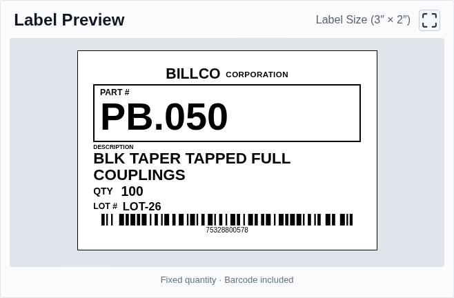 | 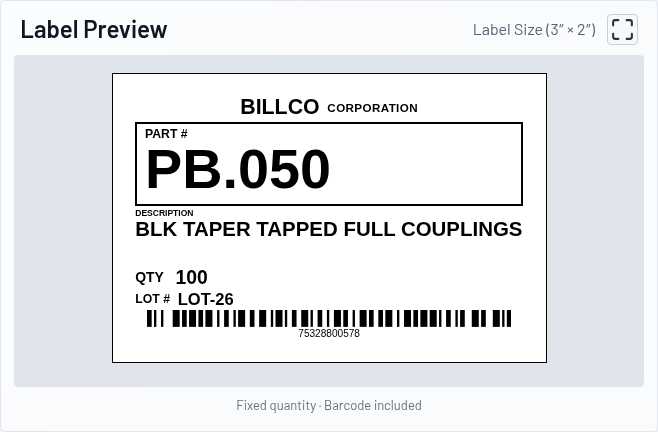 |

### PB.050 · BCC

| Before | After |
| --- | --- |
| 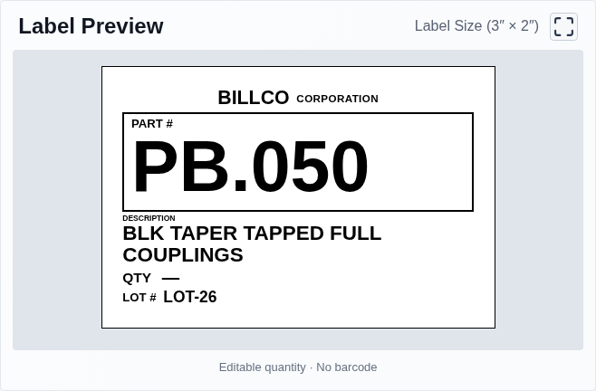 | 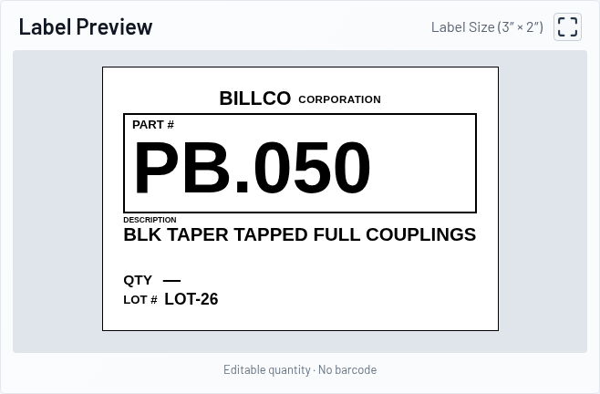 |

### PS.013 — longest-description example · Package Fixed

| Before | After |
| --- | --- |
| 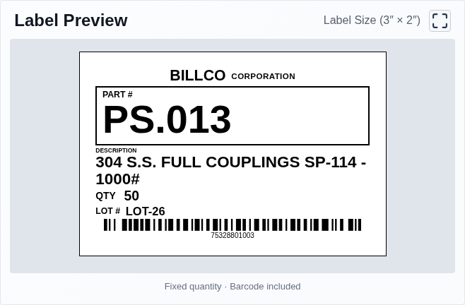 | 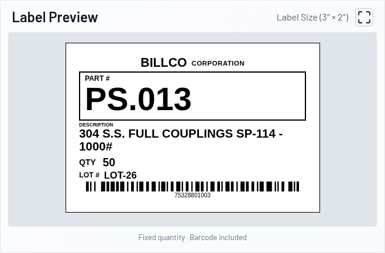 |

### PS.013 — longest-description example · BCC

| Before | After |
| --- | --- |
| 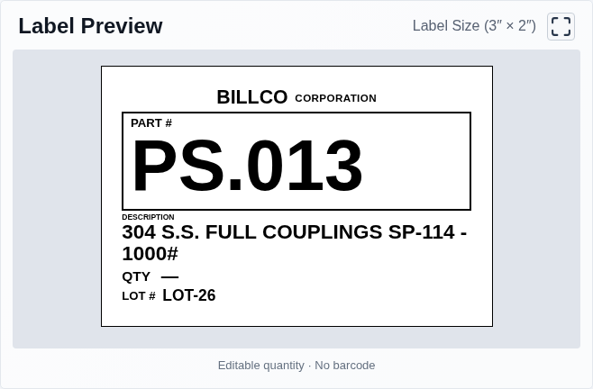 | 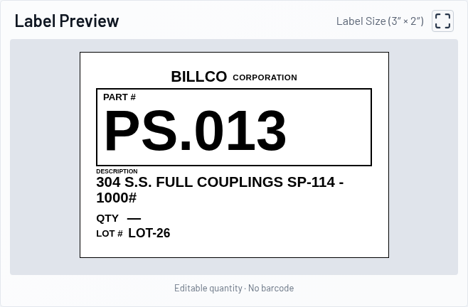 |

## Mobile comparisons

### PB.050 · Package Fixed

| Before | After |
| --- | --- |
| 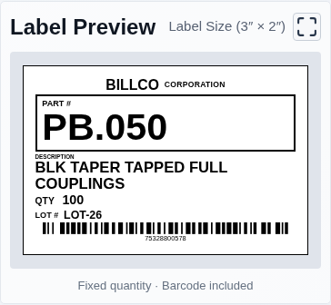 | 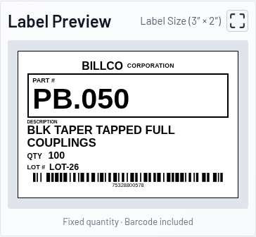 |

### PB.050 · BCC

| Before | After |
| --- | --- |
| 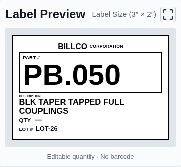 | 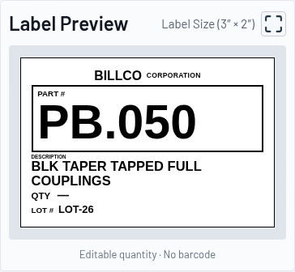 |

### PS.013 · Package Fixed

| Before | After |
| --- | --- |
| 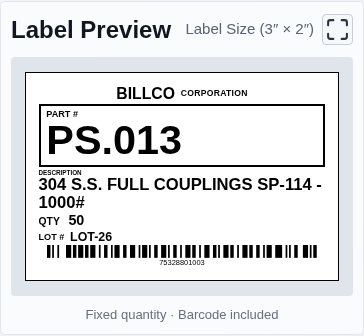 | 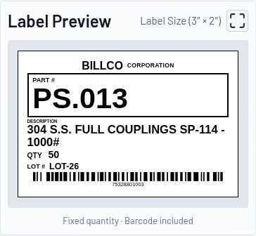 |

### PS.013 · BCC

| Before | After |
| --- | --- |
| 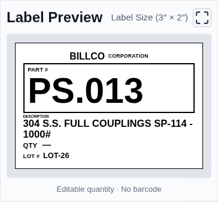 | 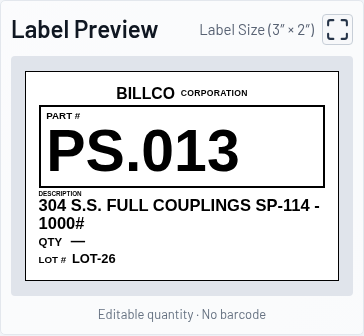 |
