# Reopened Issue #31: full workflow without scrolling

The previous implementation treated monitor height too much like browser content
height and did not test the whole interaction sequence. This follow-up reserves
180px for browser/OS chrome and verifies a 1920×900 usable content area as well as
1920×940, 1920×1000, and 1920×1080. Zoom/device scale is 100% / 1.

Baseline: merged PR #32, main commit `0071cf1`. Both sides use product 5080,
SATO example printer #1, Print Quantity 25, and Quantity 75 for variable labels.
The 1080px captures meet the requested screenshot resolution. The 900px captures
show what happens when the browser has less content height than the monitor.

## Changes

- Group Part Number/Customer, PO/LOT, and Quantity/Label Type horizontally.
- Compact the application header and sidebar on desktop.
- Preserve all primary controls with 40px inputs and a full-width description.
- Collapse print help and Print History by default; keep the recording-only
  printing notice visible.
- Reduce space surrounding the preview, preserving its full 435px width and
  725px bulk / 290px compact height. Cropped label pixels match baseline exactly
  for all four formats; no label renderer, barcode, lookup, or print service
  logic changed.
- PREVIEW focuses an already-visible panel without scrolling; smaller-screen
  navigation can still bring an offscreen preview into view.

## Measurements at 1920×900

| Format | Before document height | After document height | Before PRINT top | After PRINT top |
| --- | ---: | ---: | ---: | ---: |
| Bulk Fixed Qty | 999px | 900px | 811px | 691px |
| Package Fixed Qty | 999px | 900px | 811px | 691px |
| Bulk Variable Qty | 999px | 900px | 811px | 691px |
| BCC | 999px | 900px | 811px | 691px |

## Workflow verification

All four formats are tested at all four heights. The test loads a product,
changes PO/LOT and label quantity, presses PREVIEW, selects a printer/copy count,
tabs from Printer to Print Quantity to PRINT, and records the job. After every
phase it requires all primary elements inside the viewport, zero document
scroll range, `scrollY = 0`, and zero window scroll events. History/help remain
collapsed. A remaining 8px overflow from preview chrome was found by this test
and corrected without resizing the label. All four final viewport tests pass.

These are Chromium content screenshots, not physical Windows desktop captures.
The reopened issue remains open for actual-workstation acceptance; the follow-up
PR references it without an automatic closing directive. Branding is handled
independently in PR #33 and is intentionally not mixed into these comparisons.

## 1080px content height

### Package Fixed

| Before | After |
| --- | --- |
| 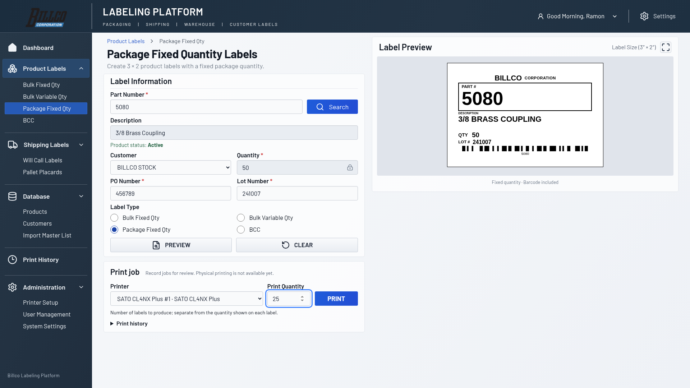 | 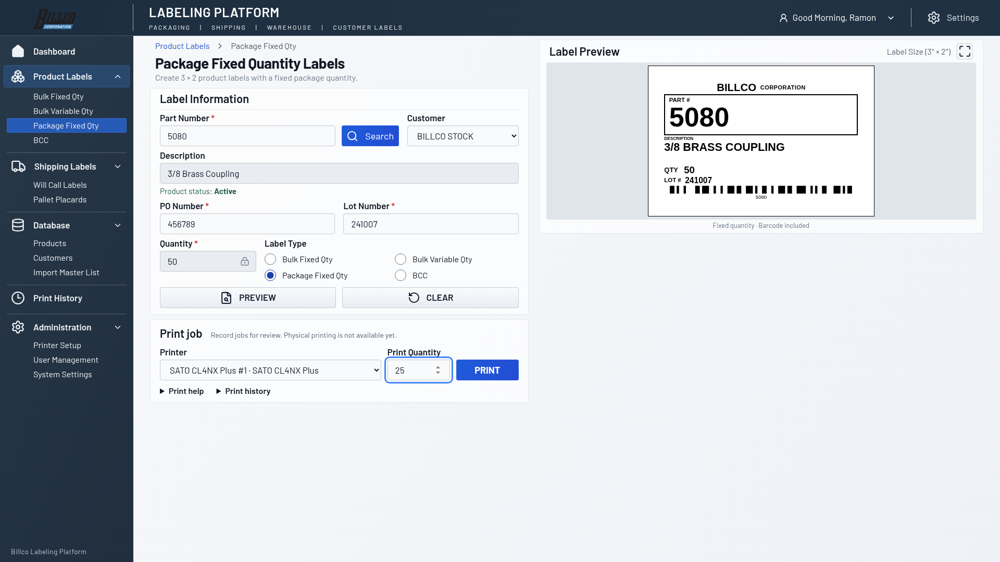 |

### Bulk Fixed

| Before | After |
| --- | --- |
| 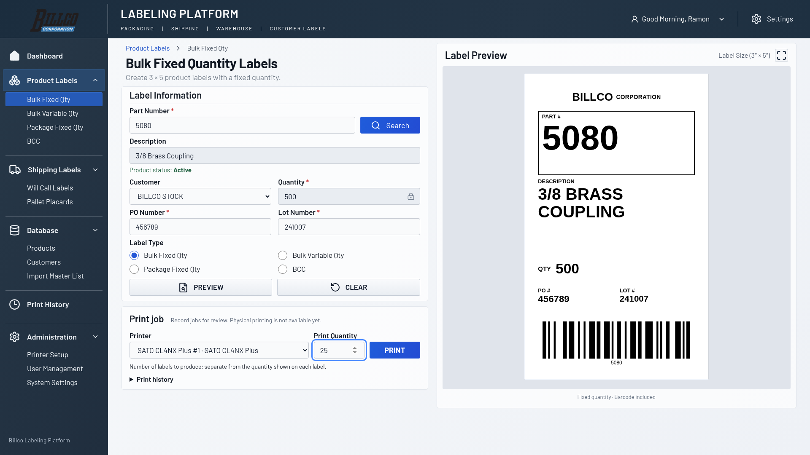 | 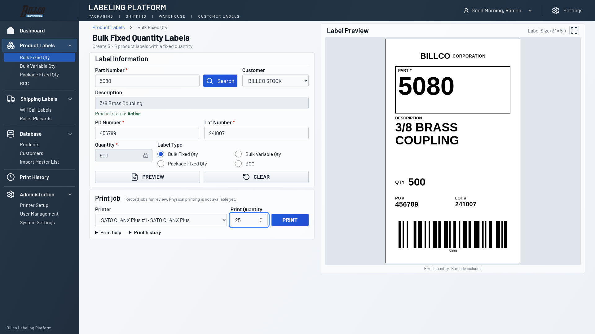 |

### Bulk Variable

| Before | After |
| --- | --- |
| 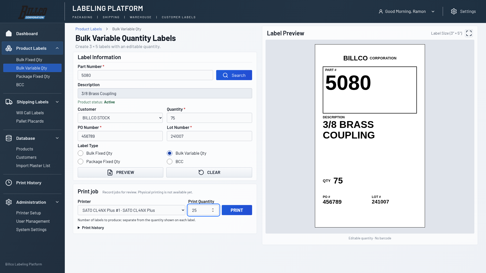 | 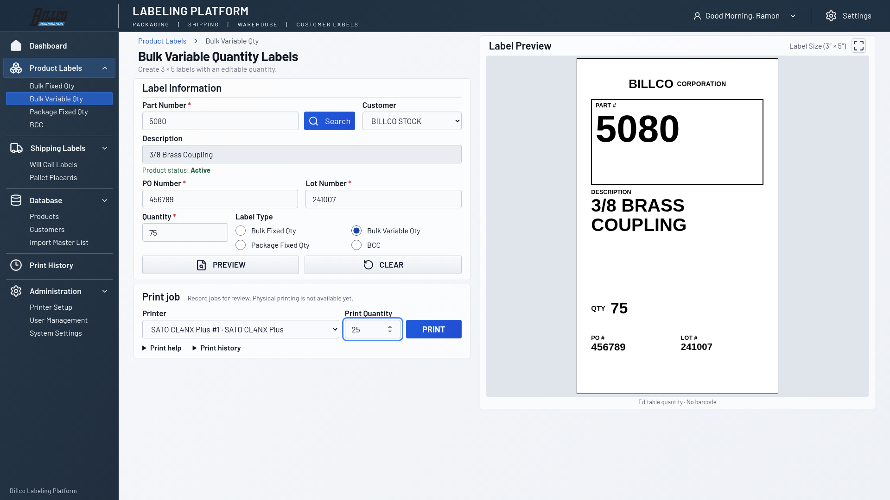 |

### BCC

| Before | After |
| --- | --- |
| 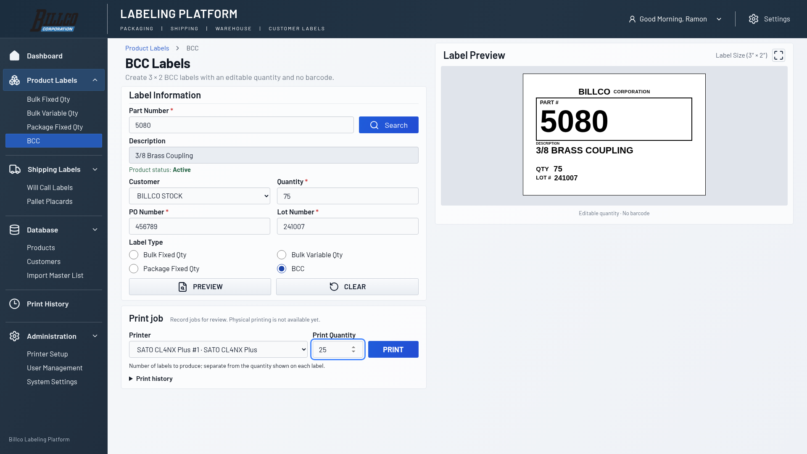 | 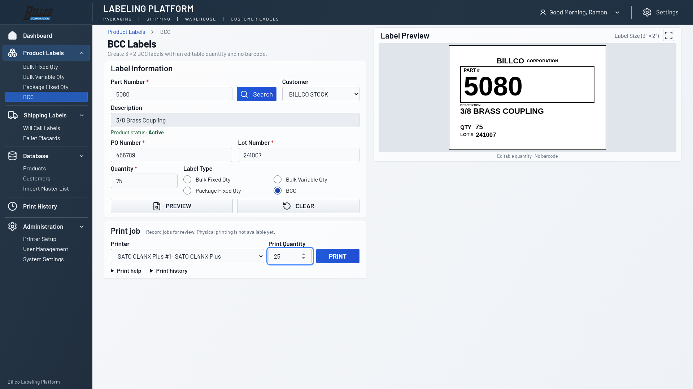 |

## 900px content height

### Package Fixed

| Before | After |
| --- | --- |
| 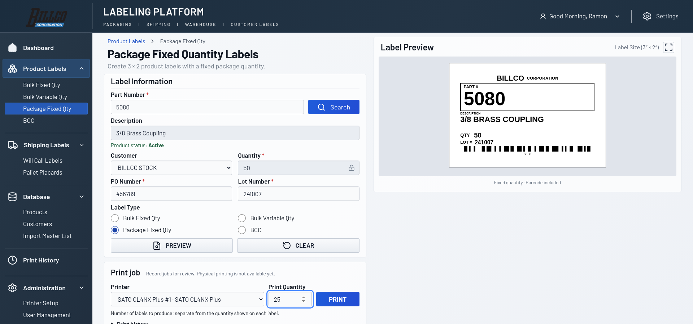 | 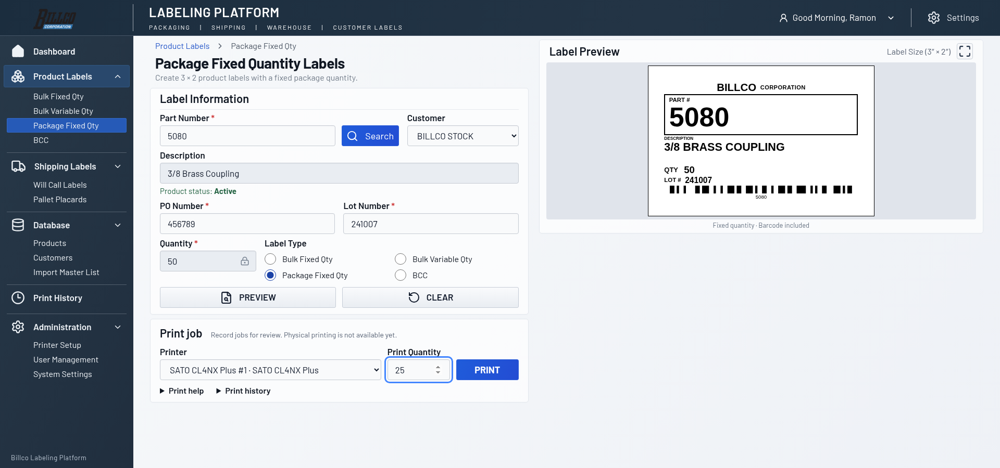 |

### Bulk Fixed

| Before | After |
| --- | --- |
| 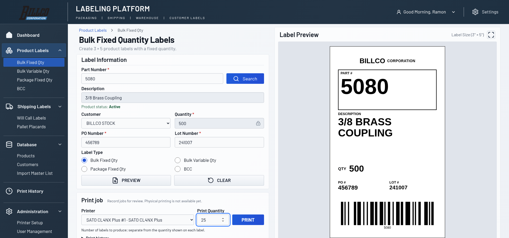 | 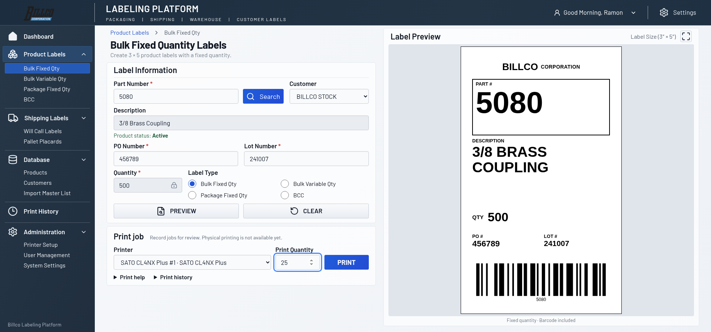 |

### Bulk Variable

| Before | After |
| --- | --- |
| 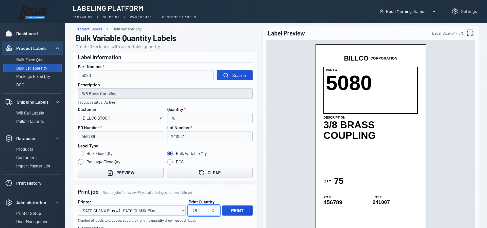 | 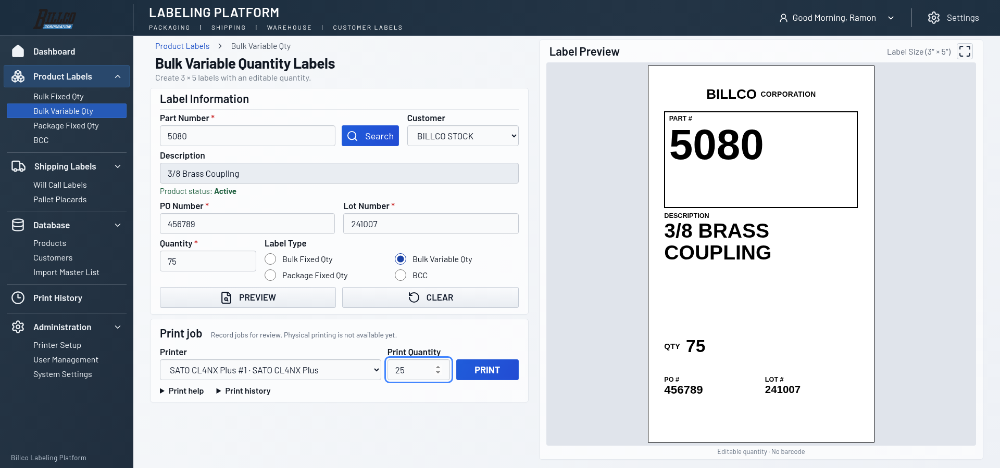 |

### BCC

| Before | After |
| --- | --- |
| 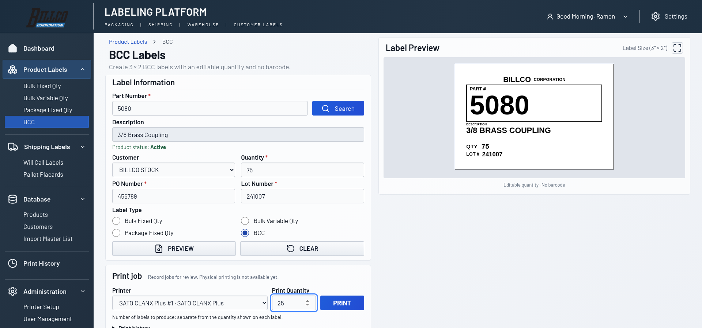 | 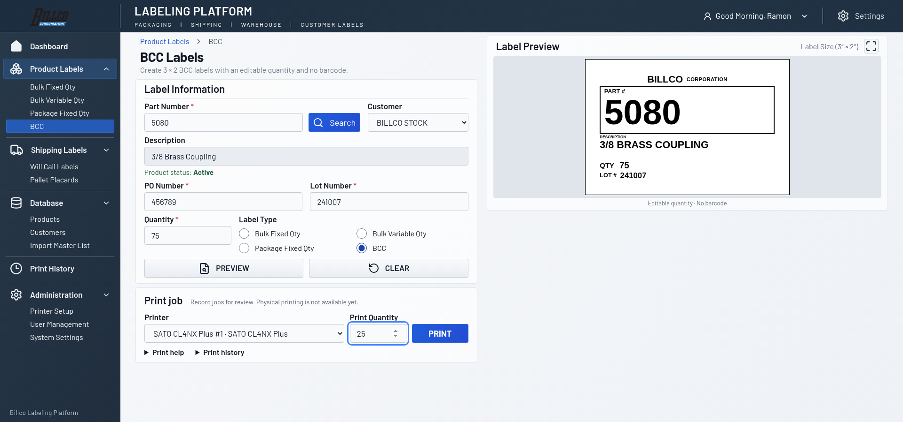 |
