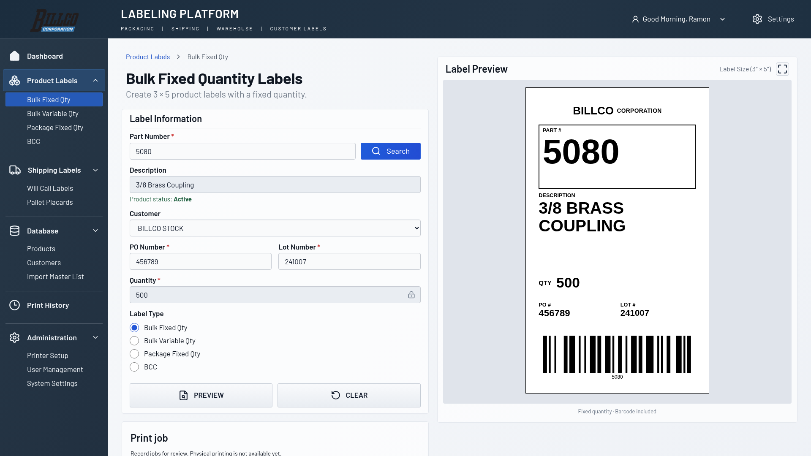
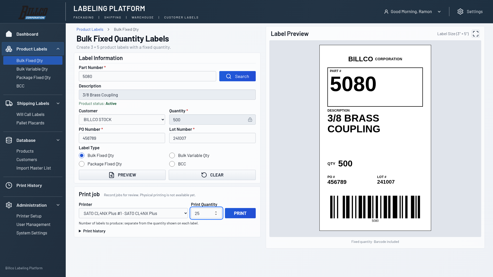
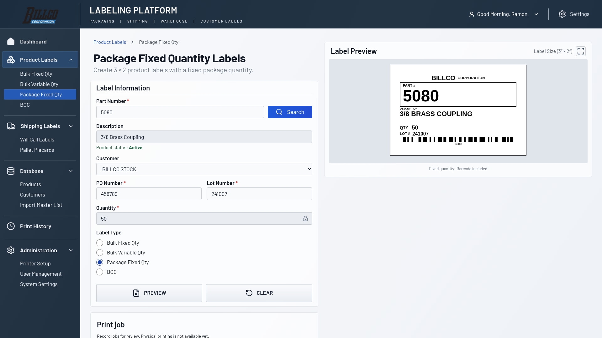
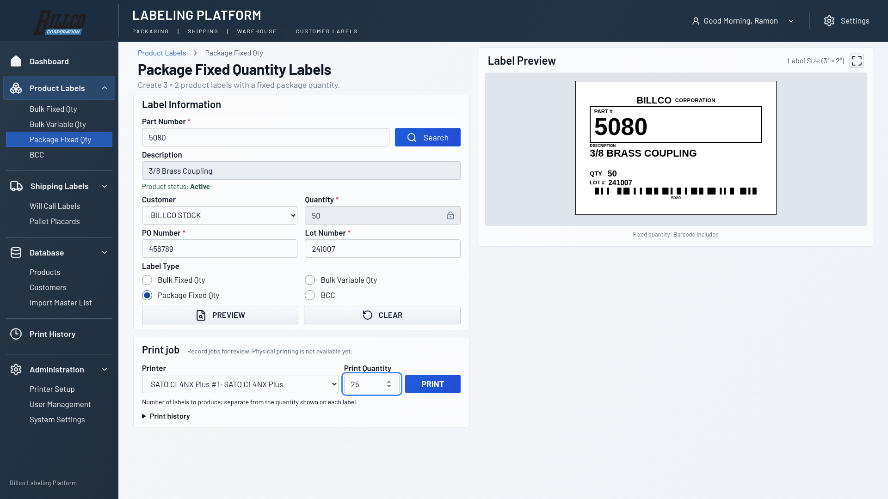
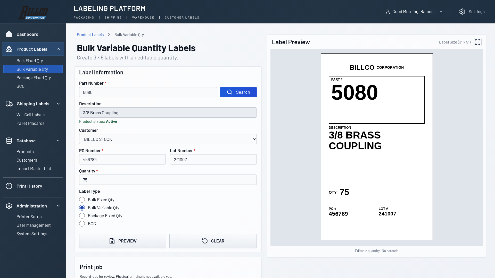
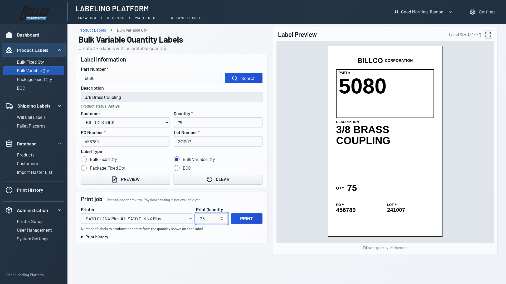
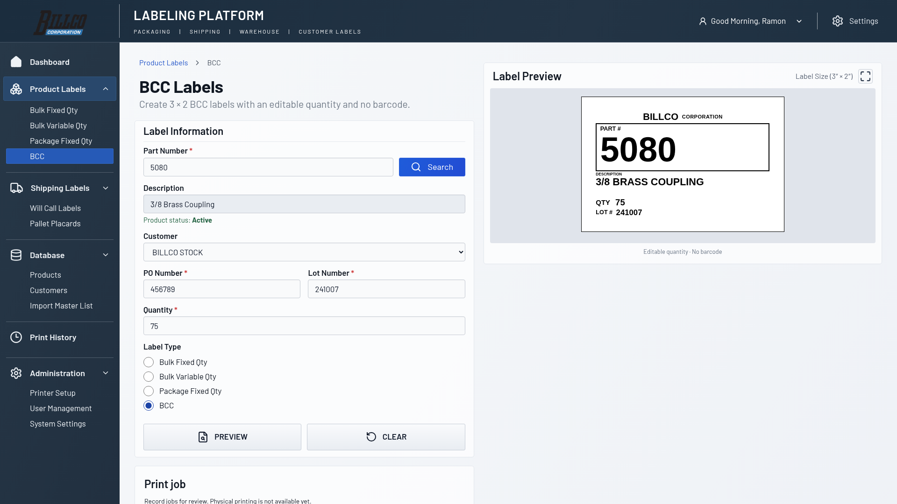
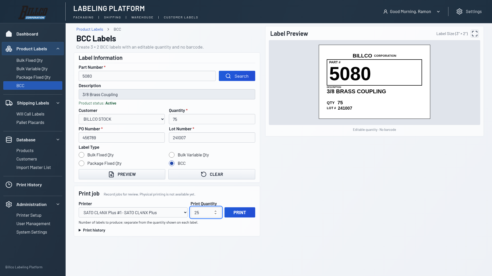

# Issue #31: One Page, No Scroll

Desktop captures use Chromium at a **1920×1080 CSS-pixel viewport**, 100% zoom,
and device scale 1. The baseline is main commit `12d9df8`; before/after use the
same seeded product 5080, example SATO printer #1, Print Quantity 25, and operator
quantity 75 for variable formats. The viewport screenshots show the actual fold;
full-page bulk captures show the entire page for comparison.

## Layout changes

- Group Customer and Quantity horizontally on desktop.
- Arrange the four label-type choices in two columns.
- Tighten desktop heading, field, and action spacing, keeping 40px inputs.
- Group Printer, Print Quantity, and PRINT in one toolbar beneath product fields.
- Keep Print History collapsed by default and preserve its existing behavior.
- Use a stacked PRINT row on narrow screens and retain the responsive preview.
- Document One Page, No Scroll as the operator workspace standard.

No label renderer, PrintJob, PrintService, lookup, or barcode logic changed.
Label widths remain 435px. Cropped before/after label PNGs were byte-for-byte
identical for all four formats, including barcode output.

## Measured desktop result

| Format | Before page height | After page height | Before PRINT top | After PRINT top |
| --- | ---: | ---: | ---: | ---: |
| Bulk Fixed Qty | 1439px | 1080px | 1290px | 811px |
| Package Fixed Qty | 1439px | 1080px | 1290px | 811px |
| Bulk Variable Qty | 1439px | 1080px | 1290px | 811px |
| BCC | 1439px | 1080px | 1290px | 811px |

## Screenshots

### Bulk Fixed

| Before | After |
| --- | --- |
|  |  |

### Package Fixed

| Before | After |
| --- | --- |
|  |  |

### Bulk Variable

| Before | After |
| --- | --- |
|  |  |

### BCC

| Before | After |
| --- | --- |
|  |  |

[Before full-page Bulk Fixed](before-bulk-fixed-full-page.png) · [After full-page Bulk Fixed](after-bulk-fixed-full-page.png)
